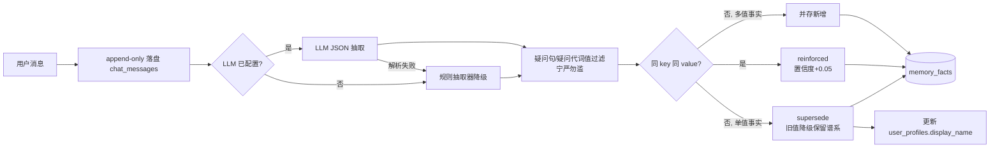
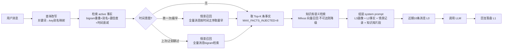

# 记忆智能体框架实现说明

> 项目：`memory-agent-api`（无会话记忆智能体 Demo）
> 本文档描述当前代码的**实际实现**，与源码一一对应，更新代码时请同步更新本文档。

## 1. 总体设计：为什么没有 session

传统聊天产品的上下文 = "当前会话内的消息列表"，切换会话即失忆。本项目的核心转变是：

> **上下文不再静态绑定某个会话，而是每次提问时动态组装的记忆视图。**

用户只有一个 `user_id`，没有任何 session 概念。每条消息进来时，系统从全量记忆中检索相关内容、拼装进 system prompt，再调用 LLM。对话本身只是记忆的**来源**和**投影**——删掉对话记录，长期记忆依然完整存在。

## 2. 用的什么记忆框架？

**没有使用第三方框架，是自研轻量实现**（约 600 行核心代码）。此前对比过 Mem0 / Letta(MemGPT) / ReMe / memU / Text2Mem / Zep：

- Mem0 等框架解决的是"逐轮事实抽取 + 去重 + 冲突消解"这条写入管线的工程化，但基础版存在硬删除无溯源、评测缺失等短板；
- 本项目的记忆能力需要完全可控（删除语义、来源追溯、防污染纪律、时间衰减），且 demo 规模下自研成本很低；
- **借鉴了三者的思想但未引入依赖**：
  - **Text2Mem**（ACL 2026）：其"key/value 结构化事实 + 生命周期治理"的算子词汇，映射为 `memory_fact` 表的 key 设计与 valid_from/valid_to 字段；
  - **Letta/MemGPT**：三层分级记忆（Core/Recall/Archival）对应本项目的 L3 画像 / L0-L1 消息 / L2 事实；
  - **Muse 设计文档**："新替旧、旧账不烧"（冲突不物理删除、保留替代谱系）与"投影有损、存档无损"（append-only 事件日志为唯一事实源）。

LLM 接入层为 **OpenAI 兼容协议**，当前配置 DeepSeek 官方 API（`api.deepseek.com/v1`，模型 `deepseek-flash`），未配置 LLM 时自动降级为离线演示模式。

## 3. 记忆分层与存储位置

所有记忆存储在腾讯云 PostgreSQL（`43.143.233.242:5432`，库 `memory_agent`，表结构由 SQLAlchemy 在应用启动时自动创建）。共 3 张表，对应 4 个记忆层：

| 记忆层 | 术语 | 存储位置 | 内容 | 生命周期 |
|---|---|---|---|---|
| **L0 短期记忆（工作集）** | 最近 N 轮对话 | `chat_messages` 表（取最近 `RECENT_MESSAGE_LIMIT=10` 条） | 原文消息，未压缩 | 随对话增长自然滚动 |
| **L1 情景记忆（事件日志）** | 全量对话存档 | `chat_messages` 表全量，**append-only 不回改** | 每条用户/助手消息原文 + 时间戳 | 永久保留（唯一事实源） |
| **L2 语义记忆（长期记忆）** | 结构化事实 | `memory_facts` 表 | 抽取出的 key/value 事实 + 置信度 + 时间窗口 + 来源 | active / superseded 状态机 |
| **L3 用户画像** | 身份与稳定偏好 | `user_profiles` 表 | display_name（当前未使用 preferences JSON 字段） | 每轮常驻注入 |

**要点：短期记忆和长期记忆不是两套系统，而是同一份数据的两个视图**——L0 是 L1 的最近窗口，L2 是从 L1 中蒸馏出的结构化事实。

### 3.1 用户偏好存在哪里？

偏好有两处，粒度不同：

1. **`memory_facts` 表（L2）**：key 以 `preference.*` 命名（如 `preference.like = 极简中文`、`preference.style = 希望回复简短`）。多值并存、可被反复印证（reinforced 置信度+0.05）。**这是偏好的主体存储**。
2. **`user_profiles` 表（L3）**：`display_name` 字段仅存称呼（`identity.name` 事实写入时同步更新）。这是高频常驻信息的"缓存视图"，每轮无条件注入。

### 3.2 `memory_facts` 表字段说明（L2 核心）

| 字段 | 类型 | 说明 |
|---|---|---|
| `user_id` | String(64) | 记忆归属用户（多租户隔离键） |
| `entity` | String(64) | 记忆主体，当前固定 `user`（预留扩展到项目/人物等实体） |
| `key` | String(128) | 事实类别，点分命名：`identity.name` / `work.current_focus` / `preference.like` / `goal.*` 等 |
| `value` | Text | 事实内容 |
| `confidence` | Float | 置信度 0~1，同一事实被再次印证时 +0.05 |
| `status` | String(16) | `active` 生效 / `superseded` 已被新事实取代 |
| `source_message_id` | BigInteger | 来源消息 ID（溯源：这条记忆是从哪句话提炼的） |
| `valid_from` / `valid_to` | DateTime(tz) | 生效时间窗；被取代时 `valid_to` 写入当时时间 |
| `last_confirmed_at` | DateTime(tz) | 最近一次印证时间（时间衰减的计算基准） |

`identity.*` 与 `work.*` 前缀的 key 为**单值事实**（新值取代旧值）；其余（如 `preference.*`、`goal.*`）为**多值事实**（不同 value 并存）。

## 4. 写路径：对话如何变成记忆

```
用户消息 → ① 消息落盘(L1) → ② 事实抽取 → ③ 冲突消解 → ④ 画像更新(L3)
```



### 4.1 事实抽取（`app/services/memory_writer.py`）

- **LLM 优先**：system prompt 要求只输出 JSON 数组（`entity/key/value/confidence`），对返回做代码围栏剥离与括号截取解析；解析失败**静默降级**到规则抽取，不阻塞对话。
- **规则降级**：三个正则覆盖 `identity.name`（我叫/叫我/以后叫我）、`work.current_focus`（负责/我管理/在做）、`preference.like`（我喜欢/请用…）。
- **防污染纪律（实测踩坑后加固）**：按句切分后，**疑问句整体跳过**；抽取值命中疑问代词（什么/谁/哪/怎么等）直接拒绝。背景：用户问"我叫什么名字？"曾被当成陈述句，抽出"什么名字"覆盖了正确记忆——错记落盘会被每轮当事实反复放大，纠正成本远高于漏记。

### 4.2 冲突消解

| 场景 | 行为 |
|---|---|
| 同 key 同 value 已存在 | `reinforced`：置信度 +0.05（上限 1.0），刷新 `last_confirmed_at` |
| 同 key 不同 value，且 key 为单值前缀 | `superseded`：旧事实 status→superseded、写入 valid_to；新事实入库。**旧记录不物理删除**，谱系可查 |
| 同 key 不同 value，多值事实 | 直接并存新增 |

`identity.name` 变更时同步更新 L3 画像的 `display_name`。

## 5. 读路径：每次提问如何组装上下文

```
用户消息 → ① 查询改写 → ② 混合评分检索 → ②' 情景记忆时间召回 → ②'' 知识库语义检索 → ③ system prompt 组装 → LLM
```



### 5.1 相关性评分公式（`memory_query.search_facts`）

```
score = 0.1（基线，冷启动保底）
      + confidence × 0.3
      + recency_decay          # 1 - min(天数/180, 0.5)，180天线性衰减，下限0.5
      + min(bigram重叠度, 1) × 1.5
      + 1.2（命中 key 别名时，如问题含"名字"→ identity.name）
```

按分数取 Top-8 注入。**诚实说明**：这是字符级评分，没有 embedding 语义召回，"我们之前讨论的那个架构问题"这类模糊指代召回不了——这是 demo 与生产级框架的主要差距之一（见 §8）。

### 5.1.1 情景记忆时间召回（`memory_query.recall_episodic`，2026-11-10 新增）

**动机（真实 bug 案例）**：用户问"我第一次提问的问题是什么？"答不出来。根因：事实检索只覆盖 `memory_facts` 结构化事实，原始消息历史只有最近 10 条窗口参与上下文，全量 `chat_messages` 没有任何读路径；且相关性评分带时间衰减——越旧的分数越低，与"第一次"的意图正好相反。

**方案**：`detect_temporal_intent` 正则检测两类时间意图，路由到对应策略：

| 意图 | 触发词 | 策略 |
|---|---|---|
| `first` | 第一次 / 最早 / 最开始 / 头一回… | 按时间正序取最早 4 条用户消息（锚点召回） |
| `past` | 上次 / 之前 / 问过 / 聊过 / 记录… | 全量消息（≤2000 条保护）bigram 检索 Top-6 |

召回结果按时间正序以【历史对话记录】块注入 system prompt，LLM 可引用原文回答。响应的 `memory.episodic` 调试块透出本轮召回了哪些消息。

### 5.1.2 知识库语义检索（`services/knowledge.py` + Milvus，2026-11-10 新增）

- **入库**：`POST /api/v1/kb/upload`（纯文本）或 `/upload-file`（.txt/.md 文件）→ 按段落聚合分块（~500 字符，重叠 50）→ fastembed 本地模型 `BAAI/bge-small-zh-v1.5`（ONNX，512 维）向量化 → 写 Milvus 集合 `kb_chunks`（owner/doc_name/chunk_index/content/embedding，AUTOINDEX+COSINE）
- **归属双层模型（2026-11-10 修正）**：企业文档是**共享资源**，owner=`global`，任何用户可查；个人上传文档 owner=各自 user_id，仅本人可查。检索合并召回 `owner == "global" or owner == 当前用户`。个人记忆（对话历史/事实）仍按 user_id 隔离——**知识库共享、记忆隔离**是两个正交维度
- **检索**：每轮对话组装上下文时，用当前问题做向量检索（Top-4，按 user_id 过滤），命中注入【知识库片段】块；计算在线程池执行避免阻塞事件循环
- **优雅降级**：Milvus 不可达时检索返回空列表、入库返回 `stored=0 + error`，主对话链路完全不受影响；`GET /api/v1/kb/status` 查看状态，服务器重启 Milvus 后 `POST /api/v1/kb/reconnect` 重连
- **注意**：`MILVUS_URI` 必须带 `http://` 前缀——pymilvus 会读取同名环境变量作为模块级默认连接串，无前缀会导致 import 崩溃；国内网络首次下载 embedding 模型需在 `.env` 配 `HF_ENDPOINT=https://hf-mirror.com`（模型已缓存后可留）
- **版本兼容**：服务器 Milvus 为 **v2.4.4**，客户端须用 **pymilvus 2.4.x**（3.x 会报 `strconv.ParseInt: parsing "null"`）；pymilvus 2.4 依赖 `pkg_resources`，需 `setuptools<81`
- **批量灌库**：`scripts/ingest_docs.py` 支持 PDF（pypdf）/ DOCX（python-docx，含表格）/ XLSX（openpyxl，按工作表）解析入向量库，图片跳过：

```bash
.venv/bin/python scripts/ingest_docs.py --user-id global --dir docs/文档资料
```

已灌入 14 个模拟企业文档（404 块，owner=global 共享），**任意 user_id 的对话都能命中**。灌私有文档把 `--user-id` 换成具体用户即可。

### 5.2 System prompt 结构

```
你是用户的长期个人助手。以下是关于用户的持久记忆（跨对话有效）。
【用户画像】称呼：老李
【长期记忆】- identity.name：老李（置信度 0.95，更新于 2026-11-09）...
【使用规则】1.优先使用记忆；2.记忆与当前消息冲突时以当前消息为准并提示更新；
           3.找不到的信息如实说明，不要编造。
```

之后拼接最近 10 条历史消息（L0）与当前用户消息一起调用 LLM。对话回复（LLM 视角"投影"可能失真，但 L1 原始日志无损，随时可回溯）。

## 6. API 一览

| 方法 | 路径 | 说明 |
|---|---|---|
| POST | `/api/v1/chat` | 对话入口。请求 `{user_id, message}`；响应含 `memory` 调试块（注入事实+分数、情景召回、知识库命中、变更列表） |
| GET | `/api/v1/memory/facts?user_id=&include_superseded=` | 查看 L2 事实（含 superseded 谱系） |
| DELETE | `/api/v1/memory/facts/{id}` | 单条遗忘（硬删除，仅用户明确指定时） |
| GET | `/api/v1/memory/profile/{user_id}` | 查看 L3 画像 |
| POST | `/api/v1/kb/upload` | 知识库纯文本入库 `{user_id, doc_name, text}` |
| POST | `/api/v1/kb/upload-file` | 知识库文件入库（multipart，.txt/.md） |
| GET | `/api/v1/kb/search?user_id=&q=` | 知识库语义检索 |
| GET | `/api/v1/kb/status` | 知识库健康状态（Milvus 连通性/分块数） |
| POST | `/api/v1/kb/reconnect` | 手动重试 Milvus 连接 |
| GET | `/health` | 健康检查（含 DB 连通性） |
| GET | `/` | 测试页面（`app/static/index.html`） |

测试页面提供：对话窗口、每轮记忆调试（注入事实/变更类型可视化）、右侧记忆谱系面板、6 个快捷测试场景（含问句防污染测试）。

## 7. 配置项（`.env`）

| 配置 | 当前值 | 说明 |
|---|---|---|
| `DB_*` | 腾讯云 43.143.233.242 / memory_agent | PostgreSQL 连接 |
| `LLM_BASE_URL` | `https://api.deepseek.com/v1` | OpenAI 兼容端点，留空=离线演示模式 |
| `LLM_MODEL` | `deepseek-flash` | （备选 `deepseek-v4-pro`） |
| `RECENT_MESSAGE_LIMIT` | 10 | L0 工作集大小 |
| `MAX_FACTS_INJECTED` | 8 | 每轮注入 L2 事实上限 |
| `MILVUS_URI` | `http://43.143.233.242:19530` | Milvus 地址，**必须带 http:// 前缀**（pymilvus 读同名环境变量），不可达时自动降级 |
| `EMBED_MODEL` | `BAAI/bge-small-zh-v1.5` | fastembed 本地 embedding 模型（ONNX，512 维，中文优化） |
| `KB_CHUNK_SIZE / OVERLAP` | 500 / 50 | 知识库分块参数 |
| `KB_TOP_K` | 4 | 每轮注入知识库片段上限 |
| `HF_ENDPOINT` | `https://hf-mirror.com` | HuggingFace 国内镜像（首次下载模型用） |

⚠️ `.env` 含数据库密码与 API Key，**禁止提交版本控制**（模板见 `.env.example`）。

## 8. 已知边界与生产化路线

当前 demo 有意保留了这些简化，升级时按优先级处理：

1. **抽取管线同步执行**：事实抽取阻塞对话响应（实测 +1~3s）。生产应改为消息队列异步消费（写入返回即结束，抽取后台完成）。
2. **记忆事实检索仍是字符级评分**：知识库已接入 Milvus 向量召回（§5.1.2），但 L2 `memory_facts` 的检索还没有 embedding 语义召回，模糊指代（"我们之前讨论的那个架构问题"）对事实层召回失效。生产应将事实也向量化，与 Milvus 混合召回 + 重排。
3. **硬删除**：DELETE 接口直接删行，无审计。生产应改为软删除 + 操作审计日志。
4. **无记忆评测**：没有量化记忆管线的 precision/recall。上线前应建回归评测集（LongMemEval 风格 + 自建真实问答）。
5. **preferences JSON 字段未启用**：L3 画像只写了 display_name；稳定偏好的结构化管理是 L2 facts 的职责，暂无合并机制。
6. **单值/多值前缀是硬编码**：`REPLACE_KEY_PREFIXES` 写死 `identity./work.`，生产应做成 key 级配置。
7. **时间衰减未闭环**：衰减只影响检索排序，没有后台任务做事实过期（expire）/晋升（promote）——即 Text2Mem 定义的 STO 阶段高阶算子，是长期准确性的下一块拼图。
